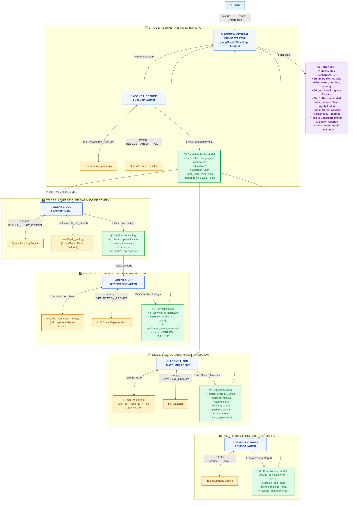

# 🔄 Multi-Agent AI Job Search System: End-to-End Data Flow Architecture

> Comprehensive specification of data transformations, agent state transitions, Pydantic schemas, and inter-agent communication protocols.

---

## 1. High-Level Visual Data Flow Diagram



---

## 2. Step-by-Step Data Flow Specification

### 📥 Stage 0: User Input & Initialization
- **Source:** Streamlit UI ([app.py](file:///c:/Users/dk845/Desktop/AIAGENTJOB/app.py)) or CLI ([main.py](file:///c:/Users/dk845/Desktop/AIAGENTJOB/main.py)).
- **Input Parameters:**
  - `resume_source`: PDF file path, raw bytes, or `UploadedFile` stream.
  - `user_preferences`: Dictionary containing:
    - `preferred_role`: Target role override (e.g. `"Java Backend Developer"`).
    - `location`: Target city or region (e.g. `"Remote"`, `"Bangalore"`).
    - `job_type`: Workplace filter (`"Any"`, `"Remote Only"`, `"Hybrid / Onsite"`).
    - `experience_level`: Target experience tier.
    - `max_jobs`: Maximum postings per query (default: 5).
- **Orchestrator Action:** Initializes the shared state dictionary `AgentWorkflowState` and compiles the `LangGraph StateGraph`.

---

### 🔍 Stage 1: Resume Perception & Structuring
- **Responsible Agent:** `ResumeAnalysisAgent` ([agents/resume_agent.py](file:///c:/Users/dk845/Desktop/AIAGENTJOB/agents/resume_agent.py))
- **Tools Triggered:** `tools/resume_parser.py` (PyMuPDF `fitz` parser).
- **Prompt Used:** `RESUME_PARSER_SYSTEM_PROMPT` & `RESUME_PARSER_USER_PROMPT` ([prompts/resume_prompt.py](file:///c:/Users/dk845/Desktop/AIAGENTJOB/prompts/resume_prompt.py)).
- **Transformations:**
  1. PyMuPDF extracts raw text and normalizes multiple newlines and whitespace.
  2. If OpenAI API key is present: LLM analyzes the text using structured JSON mode to extract deep competencies.
  3. If API is offline/unconfigured: Regex heuristic parser extracts technical skill lists, education degrees, graduation years, and target roles.
  4. Identifies industry skills missing or weak in candidate's profile relative to their target role.
- **Output Data Contract:** `CandidateProfile` ([models/schemas.py](file:///c:/Users/dk845/Desktop/AIAGENTJOB/models/schemas.py))
- **State Updated:** `state["candidate_profile"]`, `state["resume_text"]`.

---

### 🌐 Stage 2: Adaptive Query Formulation & Job Discovery
- **Responsible Agent:** `JobSearchAgent` ([agents/job_search_agent.py](file:///c:/Users/dk845/Desktop/AIAGENTJOB/agents/job_search_agent.py))
- **Tools Triggered:** `tools/apify_tool.py` (Apify Client Actor runner + `DEMO_JOB_DATABASE` fallback).
- **Prompt Used:** `SEARCH_QUERY_SYSTEM_PROMPT` & `SEARCH_QUERY_USER_PROMPT` ([prompts/search_prompt.py](file:///c:/Users/dk845/Desktop/AIAGENTJOB/prompts/search_prompt.py)).
- **Transformations:**
  1. Analyzes candidate seniority: If `total_years_experience <= 1.0` or candidate is a recent graduate, generates entry-level queries (e.g., `"Software Engineer Fresher"`, `"Junior Java Developer"`).
  2. Formulates 3 to 5 targeted search query strings combining primary languages and target roles.
  3. Dispatches concurrent scraper tasks using `ThreadPoolExecutor` via Apify Actor (`misceres/indeed-scraper`).
  4. If Apify token is missing or returns empty response, automatically loads verified demo dataset to ensure zero-crash workflow.
- **Output Data Contract:** `List[RawJobListing]` ([models/schemas.py](file:///c:/Users/dk845/Desktop/AIAGENTJOB/models/schemas.py))
- **State Updated:** `state["search_queries"]`, `state["raw_jobs"]`, `state["search_metadata"]`.

---

### 🛡️ Stage 3: Quality Auditing & Compliance Verification
- **Responsible Agent:** `JobVerificationAgent` ([agents/verification_agent.py](file:///c:/Users/dk845/Desktop/AIAGENTJOB/agents/verification_agent.py))
- **Tools Triggered:** `tools/job_verification_tool.py` (RFC URL validator, composite deduplicator, regex bounds parser).
- **Prompt Used:** `VERIFICATION_SYSTEM_PROMPT` & `VERIFICATION_USER_PROMPT` ([prompts/verification_prompt.py](file:///c:/Users/dk845/Desktop/AIAGENTJOB/prompts/verification_prompt.py)).
- **Transformations:**
  1. **URL Validation:** Confirms URL syntax, valid `http/https` protocols, and flags placeholder or broken links (`#`).
  2. **Deduplication:** Tracks unique URLs and composite key hashes `title|company|location`. Duplicate postings are marked `is_duplicate = True`.
  3. **Experience Bounds:** Extracts `min_experience_years` and `max_experience_years` from description text (e.g., `"3-5 years"` ➔ `min: 3.0, max: 5.0`).
  4. **Graduation Batch Restriction:** Extracts batch constraints (e.g., `"2024 or 2025 batch only"` ➔ `[2024, 2025]`).
  5. **Scam/Expiration Audit:** Checks for closed listings, anonymous employers, or suspicious patterns. Assigns status: `VERIFIED`, `FLAGGED`, `SUSPICIOUS`, or `EXPIRED`.
- **Output Data Contract:** `List[VerifiedJob]` ([models/schemas.py](file:///c:/Users/dk845/Desktop/AIAGENTJOB/models/schemas.py))
- **State Updated:** `state["verified_jobs"]`, `state["verification_summary"]`.

---

### ⚖️ Stage 4: Explainable Compatibility Matching
- **Responsible Agent:** `JobMatchingAgent` ([agents/matching_agent.py](file:///c:/Users/dk845/Desktop/AIAGENTJOB/agents/matching_agent.py))
- **Tools Triggered:** Mathematical 4-factor scoring algorithm.
- **Prompt Used:** `MATCHING_SYSTEM_PROMPT` & `MATCHING_USER_PROMPT` ([prompts/matching_prompt.py](file:///c:/Users/dk845/Desktop/AIAGENTJOB/prompts/matching_prompt.py)).
- **Scoring Formula:**
  $$\text{Match Score} = \text{Skill Overlap (50 pts)} + \text{Experience Alignment (20 pts)} + \text{Role Title Fit (15 pts)} + \text{Location Fit (15 pts)}$$
- **Transformations:**
  1. Identifies **Matched Skills** (candidate has them) and **Missing Skills** (job requires them, candidate lacks them).
  2. Evaluates graduation batch compatibility: If job accepts `[2024, 2025]` and candidate graduated in 2021, flags as `Ineligible`.
  3. Assigns formal `EligibilityStatus`:
     - 🟢 **Eligible:** Fully satisfies minimum experience and graduation batch rules.
     - 🟡 **Marginal:** Deficit of $\le 1$ year of experience.
     - 🔴 **Ineligible:** Major experience deficit or graduation batch exclusion.
  4. Generates a clear, grounded narrative explaining why the job matches.
- **Output Data Contract:** `List[MatchedJob]` ([models/schemas.py](file:///c:/Users/dk845/Desktop/AIAGENTJOB/models/schemas.py))
- **State Updated:** `state["matched_jobs"]`.

---

### 🧭 Stage 5: Strategic Career Advisory Synthesis
- **Responsible Agent:** `CareerAdvisorAgent` ([agents/career_advisor_agent.py](file:///c:/Users/dk845/Desktop/AIAGENTJOB/agents/career_advisor_agent.py))
- **Tools Triggered:** Cross-job frequency counter and gap aggregator.
- **Prompt Used:** `CAREER_ADVISOR_SYSTEM_PROMPT` & `CAREER_ADVISOR_USER_PROMPT` ([prompts/advisor_prompt.py](file:///c:/Users/dk845/Desktop/AIAGENTJOB/prompts/advisor_prompt.py)).
- **Transformations:**
  1. **Application Priority Queue:** Filters and ranks top verified jobs candidate should apply for first, with strategic urgency labels (`High`, `Medium`).
  2. **Systemic Market Skill Gaps:** Aggregates missing skills across all jobs to detect widespread industry requirements (e.g., Docker required in 4 out of 5 listings).
  3. **Technology Learning Roadmap:** Selects highest-ROI technologies for candidate to learn next.
  4. **Resume Optimization Advice:** Formulates concrete bullet-point suggestions to tailor candidate's resume for target positions.
  5. **Executive Summary:** Generates a strategic career assessment.
- **Output Data Contract:** `CareerAdvice` ([models/schemas.py](file:///c:/Users/dk845/Desktop/AIAGENTJOB/models/schemas.py))
- **State Updated:** `state["career_advice"]`, `state["is_completed"] = True`.

---

### 🖥️ Stage 6: Delivery & UI Presentation
- **Responsible Agent:** `MultiAgentOrchestrator` ([agents/orchestrator.py](file:///c:/Users/dk845/Desktop/AIAGENTJOB/agents/orchestrator.py))
- **Frontend Target:** Streamlit Web UI ([app.py](file:///c:/Users/dk845/Desktop/AIAGENTJOB/app.py))
- **Display Components:**
  - **Metrics Grid:** Total Discovered, Verified Legitimate, Flagged Warnings, Top Match %.
  - **Agent Status Pipeline:** Real-time completion badges for all 6 agents.
  - **4 Structured Tabs:**
    - 💼 **Tab 1 (Recommended Jobs):** Verified cards, match scores, eligibility pills, skill tags, direct application buttons.
    - 🧭 **Tab 2 (Career Advisor Guidance):** Priority queue, systemic skill gaps, learning roadmap, resume tips.
    - 👤 **Tab 3 (Candidate Profile):** Parsed profile, graduation year, target roles, formulated queries.
    - 📜 **Tab 4 (Audit Trace Logs):** Timestamped duration and status logs for all agents.

---

## 3. Data Schemas & Contracts Reference

| Model Name | Pydantic Schema Class | Key Fields |
|---|---|---|
| **Candidate Profile** | `CandidateProfile` | `name`, `technical_skills`, `programming_languages`, `frameworks`, `education`, `graduation_year`, `total_years_experience`, `target_roles`, `weak_or_missing_skills` |
| **Raw Job Listing** | `RawJobListing` | `id`, `title`, `company`, `location`, `description`, `salary`, `experience`, `job_type`, `skills`, `url`, `source`, `date_posted`, `is_demo` |
| **Verified Job** | `VerifiedJob` | `raw_job`, `is_url_valid`, `is_duplicate`, `eligibility_criteria`, `min_experience_years`, `max_experience_years`, `graduation_years_accepted`, `verification_status`, `verification_flags` |
| **Matched Job** | `MatchedJob` | `verified_job`, `match_score`, `skill_score`, `experience_score`, `title_score`, `location_score`, `matched_skills`, `missing_skills`, `eligibility_status`, `match_explanation` |
| **Career Advice** | `CareerAdvice` | `priority_applications`, `systemic_skill_gaps`, `technologies_to_learn`, `resume_improvements`, `executive_summary` |
| **Workflow State** | `AgentWorkflowState` | LangGraph `TypedDict` containing all inputs, agent outputs, execution logs, and error arrays |

---

## 4. Resilience & Error Handling Flow

```text
[External API Failure Detected]
            │
            ├──► If OpenAI API fails / rate-limited:
            │      └──► Automatically engages Heuristic Fallback Engine
            │           (Regex skills catalogue, rule-based queries, deterministic scoring)
            │
            ├──► If Apify Scraper fails / token empty:
            │      └──► Automatically engages Verified DEMO_JOB_DATABASE
            │           (Ensures the matching & advisory pipeline runs end-to-end)
            │
            └──► If PDF Parsing fails:
                   └──► Emits descriptive error in state["errors"] and halts gracefully
                        (Prevents cascading pipeline crashes)
```
